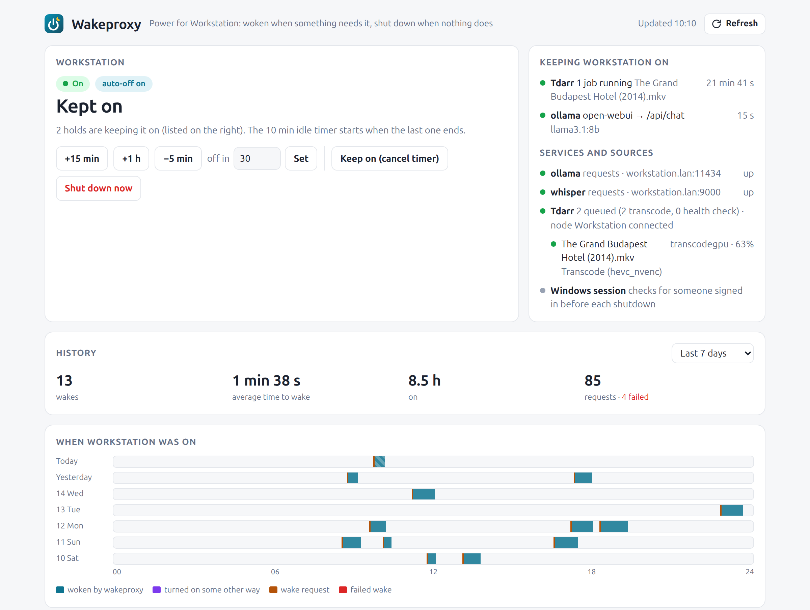

<p align="center"></p>

<h1 align="center">wakeproxy</h1>

<p align="center">Wakes a machine when something needs it, and shuts it down when nothing does.</p>

<p align="center">
  <a href="https://github.com/kdryja/wakeproxy/actions/workflows/tests.yml"></a>
  <a href="https://github.com/kdryja/wakeproxy/pkgs/container/wakeproxy"></a>
  <a href="LICENSE"></a>
</p>



Made for a GPU desktop that serves models (LocalAI, Ollama, Whisper…) and media jobs (Tdarr) to a
home server, but should stay off when idle. Clients talk to wakeproxy instead of the machine:

- A **request that does work** (a chat completion, a transcription) wakes the machine if it is off,
  waits until the service answers, and is passed through. The machine stays on while it runs.
- **Probes** (model lists, health checks) never wake it. While it is off they get a stand-in answer,
  for example the model list from the last time it was up.
- **Wake sources** watch other things that need the machine: Tdarr's queue, for instance.
- Anything else, like a backup script, can **hold** the machine on through a small HTTP API.
- When nothing has needed it for a while (10 minutes by default), wakeproxy shuts it down. It never
  shuts down a machine it did not wake, and holds off while someone is signed in and using it.
- A **status page** shows what is keeping the machine on, the countdown, and the history of wakes,
  shutdowns and requests. It also has buttons to extend, shorten or cancel the timer, and to wake
  or shut down by hand.

## How it works

Everything that needs the machine takes a **hold**:

| Source of the hold | Held while |
|---|---|
| A request through the proxy that does work | the request runs |
| A wake source (plugin), e.g. `tdarr` | it says so (Tdarr: jobs running or work queued) |
| `windows_session` | someone is signed in with the screen unlocked (at most `max_hours`) |
| The hold API | the time given, or until released |

The machine stays on while any hold is active. `idle_minutes` after the last one ends, it is shut
down, if wakeproxy woke it (or a timer was set on the status page). Taking a hold while the machine
is off wakes it first.

Turning the machine on and off, checking whether it is up, and the wake sources are all plugins,
chosen in the config file.

## Quick start (Docker)

Images for amd64 and arm64 are on GitHub's registry: `ghcr.io/kdryja/wakeproxy:latest` (the newest
release), `:1` or `:1.0` to stay on a major or minor version, and `:main` for the newest commit.

```bash
curl -O https://raw.githubusercontent.com/kdryja/wakeproxy/main/config.example.yaml
mv config.example.yaml config.yaml      # then edit it
docker run -d --name wakeproxy -p 8009:8009 -p 8010:8010 \
  -v $PWD/config.yaml:/config/config.yaml:ro -v $PWD/data:/data -v $PWD/secrets:/secrets:ro \
  ghcr.io/kdryja/wakeproxy:latest
```

Check a config without starting anything:

```bash
docker run --rm -v $PWD/config.yaml:/config/config.yaml:ro ghcr.io/kdryja/wakeproxy:latest \
  python -m wakeproxy --check
```

Or build it yourself from a clone: `docker build -t wakeproxy .`

Then point your clients at `http://<wakeproxy>:8009` instead of the machine. For example, an
OpenAI-style client gets `http://wakeproxy:8009/v1`, and a second service on another prefix gets
`http://wakeproxy:8009/whisper`. The status page is on port 8010.

`compose.example.yaml` has the same as a Compose service.

## Configuration

One YAML file. `config.example.yaml` lists every setting with its default. `${NAME}` is replaced
by the environment variable `NAME`, so secrets can stay in the environment. A wrong setting stops
wakeproxy at startup with the place in the file, e.g.
`config.sources[0] (tdarr): missing 1 required keyword-only argument: 'node'`.

- `machine`: its `name`, `idle_minutes`, `wake_timeout`, and three plugin settings:
  - `wake`: how to turn it on;
  - `shutdown`: how to turn it off;
  - `up_check`: a list of checks; the machine is up when any of them answers.
- `routes`: the services on the machine, picked by path prefix (the prefix is stripped before
  forwarding). Each route has:
  - `upstream` and `health` (the URL to check);
  - `timeout`;
  - `work`: which methods and path prefixes do work, i.e. wake and hold;
  - `while_off`: the answer to other requests while the machine is off. `cache_health` answers
    `GET <health>` with its last response.
- `sources`: wake sources. `name` (optional) is shown on the status page.
- `proxy`, `status_page`, `history`, `plugin_paths`, `log_level`.

## Built-in plugins

| Kind | Type | What it does | Options |
|---|---|---|---|
| wake | `wol` | Wake-on-LAN magic packet (from Docker: `network_mode: host`) | `mac`, `broadcast`, `port` |
| wake | `homeassistant` | Calls a Home Assistant service, by default `wake_on_lan.send_magic_packet` | `url`, `token`, `service`, `data` |
| wake | `http` | An HTTP request (smart plug, webhook) | `url`, `method`, `headers`, `body` |
| wake | `command` | A shell command in the container | `command` |
| shutdown | `ssh` | A command over SSH (defaults: Windows' `shutdown`) | `target`, `key`, `port`, `known_hosts`, `command`, `force_command` |
| shutdown | `homeassistant` | A Home Assistant service | `url`, `token`, `service`, `data`, `force_service`, `force_data` |
| shutdown | `http` | An HTTP request | `url`, `method`, `headers`, `body`, `force_body` |
| shutdown | `command` | A shell command | `command`, `force_command` |
| up_check | `tcp` | A TCP port accepts connections | `host`, `port` |
| up_check | `http` | A URL answers (status < 500, or one of `status`) | `url`, `status` |
| up_check | `ssh` | A command over SSH succeeds | `target`, `key`, `command` |
| up_check | `command` | A shell command exits with 0 | `command` |
| source | `tdarr` | Tdarr's queue wakes the machine; running jobs (and queued work, for up to `stuck_minutes`) keep it on. Pausing the node in Tdarr stops the wakes | `url`, `node`, `stuck_minutes`, `settle_minutes` |
| source | `windows_session` | A signed-in, unlocked Windows session holds off the shutdown (for `max_hours`); a signed-in, locked one makes it forced | `target`, `key`, `known_hosts`, `max_hours`, `session_command`, `lock_command` |

The `force` variants of shutdown are used when a source reports that someone is signed in, so
programs left open cannot stop the shutdown.

## The hold API

On the proxy port:

```bash
# keep the machine on for 2 hours, waking it first; answers once it is up
curl -X POST http://wakeproxy:8009/_wakeproxy/hold/backup \
     -H 'Content-Type: application/json' -d '{"minutes": 120, "reason": "nightly backup"}'
# done early
curl -X DELETE http://wakeproxy:8009/_wakeproxy/hold/backup
# the state, as JSON
curl http://wakeproxy:8009/_wakeproxy/status
```

The JSON fields:
- `minutes` (1–1440, default 60). Post again to renew.
- `reason` (shown on the status page).
- `wake` (default `true`).
- `ready`: a route name to wait for, instead of just the machine.

API holds survive a restart of wakeproxy. Times in all JSON answers (`until`, `since`,
`deadline`…) are Unix times in seconds. With `proxy.hold_token` set, these calls need
`Authorization: Bearer <token>`.

## Security

- **Status page:** it has no login of its own, and it can shut the machine down. Put it behind a
  reverse proxy that authenticates (Authelia, Authentik, oauth2-proxy…), and list that proxy's
  address in `status_page.trusted_proxies`; other callers are refused. `user_header` names the
  header carrying the user name, for the history.
- **Proxy port:** anyone who can reach it can wake the machine. Keep it on an internal network,
  and set `hold_token` if the hold API should be restricted.
- **SSH:** use a key that may only run the shutdown command if you can (`command=` in
  `authorized_keys`, or a sudo rule). `known_hosts` remembers the host key after the first contact.

## Writing a plugin

A plugin is a class with `kind` and `type`. Options from the config arrive as keyword arguments.
Put the file in a directory listed in `plugin_paths`, or install it as a package and use
`type: package.module:ClassName`.

```python
from wakeproxy.plugins import Source

class Backups(Source):
    """Keeps the machine on while a backup job runs on the NAS."""
    type = "nas_backup"
    interval = 60

    def __init__(self, ctx, *, url):
        super().__init__(ctx)
        self.url = url

    async def poll(self):
        async with self.ctx.http.get(self.url) as r:
            running = (await r.json())["running"]
        if running and not self.ctx.pc_up:
            self.ctx.wake("backup is running")
        elif running:
            self.ctx.hold("job", "backup running")
        else:
            self.ctx.release()
```

```yaml
plugin_paths: [/config/plugins]
sources:
  - type: nas_backup
    url: http://nas:8080/api/backup
```

`self.ctx` (see `wakeproxy/core.py`, `PluginContext`) gives:
- `hold(key, label, detail=None, until=None, grace=True)` and `release(key=None)`;
- `wake(text, ready=None)`;
- `event(text, level)`, for a line in the history;
- `pc_up`, `managed`, `waking`, `shutting_down`;
- `store` (a dict kept across restarts) and `save()`;
- `now()` and `http`, a shared aiohttp session.

Sources may also implement:
- `before_shutdown()`: take a hold to stop a shutdown;
- `on_machine_off(by)`;
- `status()`: the source's line in the status page's list, `{"summary", "state", "rows", "note"}`.
  The default shows `describe()`.

Times inside texts for the page (hold labels, notes, `status()`) should be written with
`wakeproxy.plugins.at(ts)`, so the page shows them in the viewer's time zone.

Wake, shutdown and check plugins subclass `PowerOn`, `PowerOff` and `Check`, implementing
`power_on()`, `power_off(force)` and `check()`. The built-ins in `wakeproxy/plugins/` are short
examples of each.

## Development

```bash
pip install -e '.[test]'
pytest
```

The tests use a fake clock, a fake machine, a fake Tdarr server and a fake upstream service, so
they need nothing else running. GitHub Actions runs them on Python 3.11 to 3.13 for every push
(`.github/workflows/tests.yml`), and `image.yml` publishes the image: `:main` for every push to
`main`, version tags for a release. To release, tag a commit `v1.2.3` and push the tag.

The screenshot is made with `python docs/demo.py > demo.html` (made-up data run through the real
code), opened in a browser 1200 px wide.

## License

MIT
